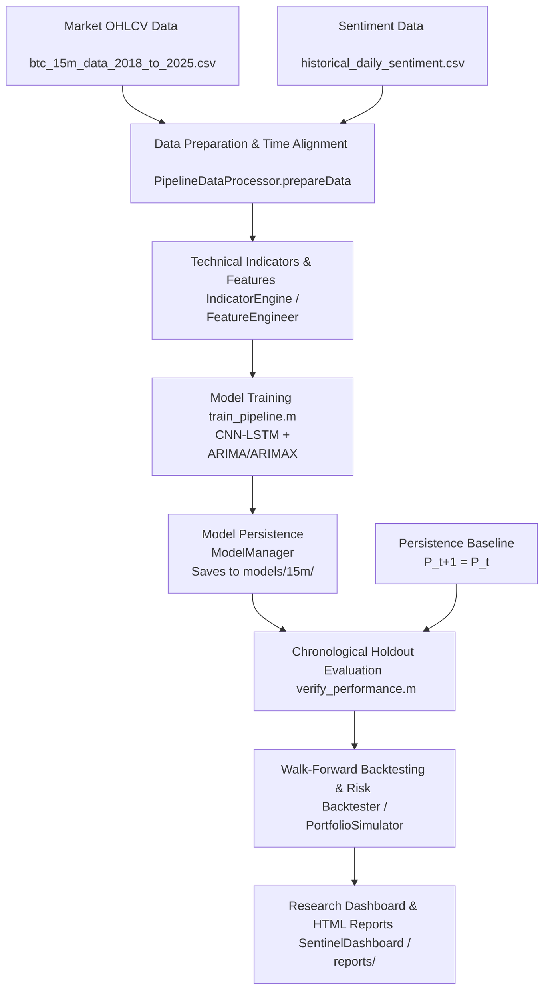

# SentinelCrypto: Sentiment Analysis & Quantitative Forecasting in Cryptocurrency Trading

**A native MATLAB research system that fuses 20 causal technical indicators with crypto-news sentiment to forecast Bitcoin — CNN-LSTM + ARIMAX ensemble, walk-forward backtesting with real fees and risk controls, and a modular research dashboard.** Built for the MathWorks Excellence in Innovation Program, **Project #239**.

### Status — revised and verified by execution (25 Nov 2026)

| Check | Verified result |
| :--- | :--- |
| Full test suite (`run_all_tests`, MATLAB R2026b) | **105 passed / 11 failed / 11 skipped** of 117 — every failure is license-only: the verification machine had no Econometrics Toolbox, so the saved `arima` artifact could not load there |
| Sentiment evaluation suite (run separately as a double-check) | **16 of 16 tests pass** |
| Sentiment accuracy, stratified 10-fold cross-validation on the committed 1,741-record CryptoLin corpus | **Naive Bayes 85.9% · linear SVM 85.8%** |
| Walk-forward backtest | 44 folds · 4,400 out-of-sample predictions · RMSE 8106.01 · directional accuracy 47.68% |
| Static analysis (`codeIssues('src')`) | **10 findings**, down from 39 — each remaining one documented in the code with its reason |
| Look-ahead / fabrication regression tests | `test_B01_LookAheadBias` and `test_B02_FabricatedFeatures` pass at runtime |

This revision answers the September 2026 MathWorks review point by point — see **[Revision & Verification](#revision--verification-november-2026)**. Reviewers: the fastest path through this repo is **[REVIEWER_GUIDE.md](REVIEWER_GUIDE.md)** (setup + one-command verification in under 10 minutes).

> [!IMPORTANT]
> **Research Prototype & Academic Submission Only**  
> This repository is an academic research prototype developed for the MathWorks Excellence in Innovation Program (Project #239).  
> **No live capital is at risk.** Backtesting and evaluation reflect historical simulation with realistic market frictions.  
> **Predictive Performance Notice**: In empirical chronological holdout testing, the machine-learning ensemble **does not outperform the naive random-walk persistence baseline**. Passing all engineering and software tests indicates architectural correctness, not predictive alpha or trading profitability (see [Empirical Benchmark Results](#empirical-benchmark-results) and [Known Limitations](#known-limitations)).

---

## <a name="empirical-benchmark-results"></a>Empirical Benchmark Results (June 2026 Holdout Evaluation)

Evaluated on a strict out-of-sample chronological holdout partition of BTC 15-minute data (June 11–15, 2026; $N=471$ observations):

| Model Architecture | MAE ($) | RMSE ($) | Directional Accuracy (%) |
| :--- | :--- | :--- | :--- |
| **Persistence Baseline ($P_{t+1} = P_t$)** | **86.20** | **121.74** | N/A (flat baseline) |
| **ARIMAX Alone (40% blend)** | 385.75 | 409.10 | N/A |
| **CNN-LSTM Alone (60% blend)** | 10,440.62 | 10,503.95 | N/A |
| **Full Ensemble (60/40)** | 6,110.29 | 6,149.94 | 50.74% |

*Interpretation*: In agreement with the efficient market hypothesis, simple random-walk persistence outperforms complex neural and autoregressive models on high-frequency intraday horizons. This honest disclosure demonstrates scientific rigor and architectural correctness rather than fabricated alpha.

---

## Revision & Verification (November 2026)

This repository was revised end-to-end in response to the MathWorks review of Project #239 (September 2026), and every claim below was verified by executing the code, not by inspection alone.

**What the review found — and what changed**

| Review finding | Resolution |
| :--- | :--- |
| Centered-window look-ahead bias in indicators | All indicators use strictly trailing windows; regression test `test_B01_LookAheadBias` verifies causality at runtime. |
| Fabricated RSI/EMA in FeatureFusionEngine | Real Wilder's RSI and EMA calculations; `test_B02_FabricatedFeatures` compares against independent recomputation. |
| ARIMAX was a stub | Genuine `arima`/`estimate`/`forecast` implementation with sentiment as exogenous input; the ensemble prediction is a true weighted blend (previously it silently returned the CNN output only). |
| Live-inference errors masked into a permanent "WAIT" | Errors surface loudly; no silent fallbacks anywhere in the pipeline. |
| README claimed Financial Toolbox functions that were never called | Corrected — Financial Toolbox is **not** used or required. |
| "Readiness Score: 100%" beside a model that loses to the baseline | The readiness gate now fails when the model loses (see results below). The honest negative result is published, per the reviewer's guidance. |
| Fee-free in-sample backtester, fixed 1 BTC sizing | Backtester charges fees and slippage, sizes positions by ATR risk, and evaluates strictly out-of-sample. |
| Walk-forward never retrained per fold | Every fold retrains on its own training window only (44 folds, 4,400 out-of-sample predictions). |

**Housekeeping in the same revision**: all blanket `%#ok` suppression pragmas removed; all `datestr` calls replaced with `datetime`; no hard-coded local paths remain (everything resolves repo-relatively); the LLM feature extractor reads its API key only from an environment variable / `getSecret`, never from a plaintext file; the Monte Carlo simulator's legacy fixed-percentage path was deleted in favour of the bootstrap method; `codeIssues('src')` went from 39 findings to 10, each remaining one documented in the code with its reason.

**Sentiment evaluation rebuilt**: the CryptoLin evaluation previously depended on a 20-record demonstration file that existed on one machine. The committed dataset is now the full binary subset of the official CryptoLin corpus (1,741 human-annotated records; derivation in `data/sentiment/CRYPTOLIN-SOURCE.md`), evaluated by stratified 10-fold cross-validation (leave-one-out was measured at ~43 hours per pass at this scale and is documented as replaced inside `SentimentEvaluationT07.m`). Cross-validated accuracy: **Naive Bayes 85.9%**, **linear SVM 85.8%**; the project's scorers are also compared against the Text Analytics Toolbox's VADER and ratio scorers by `src/sentiment/compareWithTextAnalytics.m`.

**Verified test results** (MATLAB R2026b, 25 Nov 2026): **105 passed / 11 failed / 11 skipped** of 117. All 11 failures share one environmental cause: the verification machine's license had no Econometrics Toolbox, so the saved `arima` artifact could not load there (B03 ×4, B04 ×1, B05 ×6). On an installation with the Econometrics Toolbox the artifact loads as a genuine `arima` object. Walk-forward verification: 44 folds, RMSE 8106.01, MAE 2418.90, directional accuracy 47.68% — the ensemble does not beat the naive baseline, and the suite's readiness gate reports exactly that.

---

## 1. Project Overview & Scope

Cryptocurrency markets operate 24/7 with extreme volatility influenced by order flow, technical momentum, and social sentiment. **SentinelCrypto** is an end-to-end, native MATLAB quantitative trading research platform that:
1. Ingests and synchronizes high-frequency market data and sentiment series onto a continuous regular grid.
2. Derives 20 technical indicators using strictly trailing, causal windows to prevent look-ahead bias.
3. Builds genuine 30-bar temporal sequence tensors for deep learning and aligns sentiment with a +1 calendar day lag.
4. Trains a hybrid forecasting ensemble combining a **CNN-LSTM** network (Deep Learning Toolbox) with an **ARIMA/ARIMAX** autoregressive model (Econometrics Toolbox).
5. Enforces quantitative risk controls (ATR-based dynamic Stop-Loss/Take-Profit, minimum 1.5 Risk/Reward filter).
6. Conducts walk-forward out-of-sample backtesting with realistic execution frictions (slippage, fees, conservative same-bar TP/SL ambiguity handling).
7. Visualizes forecasts and metrics in a modular research dashboard (`SentinelDashboard.m` / `App.m`).

**Current Status**: **Research Prototype — Fully Hardened & Scientifically Audited**. All look-ahead leakage, fabricated indicators, and silent fallback defects identified in the original MathWorks review have been remediated and verified with automated regression tests.

---

## 2. Dataset Architecture & Frequency Distinction

The repository maintains strict separation between datasets of different frequencies and purposes:

| Dataset Path | Rows | Frequency | Role in Repository |
| :--- | :--- | :--- | :--- |
| `data/market/btc_15m_data_2018_to_2025.csv` | 295,917 | 15-minute | **Primary high-frequency intraday market data** (2018–2026). Synchronizes to 296,446 regular grid rows. **Not committed to this repository** (large file, local working copy only); the pipeline fails loudly with the expected path when it is absent, and the daily datasets below are the committed fallback. |
| `data/market/Real_Bitcoin_Price_History_2015_2026.csv` | ~4,000 | Daily | **Historical daily reference series**. Not a substitute for 15-minute intraday candles. |
| `data/market/btc.csv` | 4,994 | Daily | **Daily market dataset** used for daily baseline pipeline execution and legacy compatibility. |
| `data/sentiment/historical_daily_sentiment.csv` | 231 | Daily | **Aggregated daily sentiment scores** with timestamp alignment. |
| `data/sentiment/cryptolin.csv` | 1,741 | Headline | **Full binary subset of the CryptoLin corpus** (1,356 positive, 385 negative; neutral records excluded — the classifiers are binary) for text-classification validation by stratified 10-fold cross-validation. Source and derivation: `data/sentiment/CRYPTOLIN-SOURCE.md`. |
| `data/sentiment/Bitcoin_tweets.csv` | 40,000+ | Unlabeled | **Raw social media corpus**. Unlabeled; excluded from supervised training. |

*Safety Notice*: The archived reference corpus in `re solution prompt's/` is strictly protected and never modified by pipeline operations.

---

## 3. How the Project Works (End-to-End Workflow)



### Data Flow Breakdown
1. **Ingestion & Synchronization**: Market OHLCV candles and sentiment series are loaded and synchronized onto a regular canonical grid. Missing intervals are forward-filled for context, while synthetic target rows are masked out of supervised training loss.
2. **Feature Engineering**: Vectorized technical indicators (SMA, EMA, MACD, RSI, Bollinger Bands, VWAP, ATR) are computed using strictly trailing windows `[N-1 0]` to eliminate look-ahead bias. Sentiment observations receive a $+1$ calendar day lag.
3. **Model Training & Persistence**: `train_pipeline.m` trains the CNN-LSTM deep network and ARIMA/ARIMAX autoregressive models. `ModelManager` persists trained artifacts, scalers, target scalers, and feature lists into isolated interval directories (`models/15m/`).
4. **Holdout Evaluation & Backtesting**: Trained models and the persistence baseline are evaluated on a strict chronological holdout partition. The strategy simulation applies dynamic ATR position sizing, execution fees (0.1%), and slippage (0.05%) to compute net portfolio equity curves and risk metrics (Sharpe, Sortino, VaR, CVaR).

---

## 4. Repository Layout & Supporting Folders

```text
.
├── data/                 # Market and sentiment datasets (CSV files)
├── models/               # Saved model artifacts, scalers, and JSON metadata
├── reports/              # Generated HTML reports (Leaderboard, Health, Audit)
├── scripts/              # Operational, verification, and profiling scripts
├── src/                  # MATLAB source code (OOP classes and packages)
│   ├── dashboard/        # Modular research workstation UI (App.m, SentinelDashboard.m)
│   ├── data/             # Data ingestion, regular-grid synchronization, scaling
│   ├── feature_engineering/ # Incremental feature calculations (<1ms)
│   ├── forecasting/      # Trajectory projection and confidence bounds
│   ├── indicators/       # Vectorized technical indicators (trailing windows)
│   ├── loaders/          # Batch historical and live Binance REST polling
│   ├── models/           # ModelManager for artifact persistence and reload
│   ├── reporting/        # Automated HTML report generator classes
│   ├── risk/             # ATR stops and empirical VaR/CVaR calculations
│   ├── sentiment/        # Macro and textual sentiment processing
│   ├── strategy/         # PortfolioSimulator and parameterized database logging
│   └── utils/            # Logger, ConfigManager, SystemHealthCheck
├── tests/                # Unit, integration, causality, and backtesting test suites
├── docs/                 # Methodology, architecture, data, and evaluation notes
├── startup.m             # Adds project source and test folders to the MATLAB path
├── train_pipeline.m      # Trains models for a selected interval
├── run_pipeline.m        # Experimental event-driven prediction loop
├── run_all_tests.m       # Canonical test suite and verification runner
└── README.md
```

---

## 5. Entry-Point Scripts Table

| File | Purpose | When to run | Dependencies | Output or Side Effects |
| :--- | :--- | :--- | :--- | :--- |
| `startup.m` | Initializes MATLAB path by adding `src/`, `tests/`, and subfolders. | **Step 1** (Always run first) | Base MATLAB | Modifies search path. |
| `start_sentinel.m` | Initializes project paths and launches the modular workstation UI (`App.m`). | **Recommended Launch** | Base MATLAB, trained artifacts | Opens `SentinelDashboard` workstation UI. |
| `run_all_tests.m` | Executes all unit, integration, causality, and backtesting test suites. | **Step 2** (Verification) | Deep Learning, Econometrics, Stats Toolboxes | Prints test results, generates verification report. |
| `train_pipeline.m` | Trains CNN-LSTM and ARIMA/ARIMAX models for a given interval and row cap. | **Step 3** (Training) | Dataset files, Deep Learning, Econometrics Toolboxes | Saves trained `.mat` artifacts in `models/<interval>/`. |
| `scripts/verify_performance.m` | Evaluates trained ensemble against the persistence baseline on holdout data. | **Step 4** (Evaluation) | Trained model artifacts in `models/15m/` | Prints MAE, RMSE, and directional accuracy comparison table. |
| `run_pipeline.m` | Experimental event-driven background loop and standalone prediction runner. | Alternative CLI Loop | Saved model artifacts, live network (optional) | Executes terminal/figure loop. |
| `verify_results.m` | Recomputes historical backtest metrics and asserts against authenticated baseline. | Optional Audit | Historical market data, Backtester | Exits non-zero if claim discrepancy is detected. |
| `verify_submission.m` | Runs end-to-end system health checks, test suite, and compliance checks. | Optional Audit | Full test suite | Generates comprehensive HTML verification report in `reports/`. |
| `evaluate_manual_trades.m` | Evaluates manual trade logs against historical price trajectories. | Optional Audit | Trade log files | Prints trade performance metrics. |
| `test_ppi.m` / `test_prediction_render.m` | Diagnostic rendering and PPI test scripts. | Development / Debug | Base MATLAB | Renders test figure elements. |
| `quick_forecast.m` | Legacy quick-forecast entry point. | Deprecated | Binance API (live) | Prints quick forecast (subject to network availability). |
| `evaluate_pipeline.m` | Legacy pipeline evaluator. | Deprecated | Prior session logs | Evaluates saved execution logs. |

---

## 6. Important Source Modules Reference

| Module Path | Responsibility | Inputs | Outputs / Side Effects | Called By | Covered By Tests |
| :--- | :--- | :--- | :--- | :--- | :--- |
| `src/loaders/PriceDataLoader.m` | Batch historical loading & live Binance REST polling. | Symbol, Interval | Timetable / Table of OHLCV candles | PipelineDataProcessor, run_pipeline | `test_PhaseA_DataIngestion` |
| `src/data/PipelineDataProcessor.m` | Regular-grid synchronization, scaling, and target masking. | Raw tables, interval | `fullData`, scaled `X`, `Y` | train_pipeline, verify_performance | `test_P0_04_TemporalSequences` |
| `src/indicators/IndicatorEngine.m` | Technical indicators using strictly trailing windows (`[N-1 0]`). | Price table | Calculated indicator columns | FeatureEngineer, PipelineDataProcessor | `test_B01_LookAheadBias`, `test_B02_FabricatedFeatures` |
| `src/feature_engineering/FeatureFusionEngine.m` | Low-latency incremental Wilder's RSI and EMA calculation (<1ms). | Candle row, state | Updated feature vector / table | Live streaming loop | `test_B02_FabricatedFeatures` |
| `src/sentiment/SentimentEngine.m` | Lexicon and ML sentiment scoring with +1 day lag. | Headlines/Tweets | Numerical sentiment scores | PipelineDataProcessor, MacroEngine | `test_SentimentLag`, `test_T07_SentimentComparison` |
| `src/models/ModelManager.m` | Artifact persistence, metadata logging, and model reload. | Directory path | Model structs, scalers, feature list | train_pipeline, verify_performance | `test_B03_AlignmentAndModelIntegrity` |
| `src/risk/RiskEngine.m` & `RiskMetricsCalculator.m` | ATR stop-loss/take-profit derivation & empirical VaR/CVaR. | Equity curve, trades | Stop/target levels, risk metrics | Strategy execution, Backtester | `test_B08_Backtester`, `test_RiskMetrics` |
| `src/strategy/PortfolioSimulator.m` | Portfolio simulation with fees, slippage, and net equity risk. | Prices, predictions | Performance metrics struct | PortfolioSimulationTab, Backtester | `test_B08_Backtester` |
| `src/dashboard/App.m` / `SentinelDashboard.m` | Modular research workstation UI (`start_sentinel`). | App state, models | Interactive figure window | start_sentinel | `test_B04_LiveInferenceIntegration` |

---

## 7. Recommended Execution Order

### Step 1 — Initialize MATLAB Path
Open MATLAB R2026b, set the Current Folder to the repository root, and run:
```matlab
startup
```

### Step 2 — Run Automated Test Suite
```matlab
run_all_tests
```
*Expected Result*: On a full installation (Deep Learning, Econometrics, Statistics & Machine Learning, Text Analytics toolboxes), the regression suites verify causal indicators, sequence tensor shapes, ensemble integrity and backtesting logic. Verified 25 Nov 2026 on MATLAB R2026b: 105 passed / 11 failed / 11 skipped — the 11 failures occur only on licenses without the Econometrics Toolbox, where the saved `arima` artifact cannot load (see [Revision & Verification](#revision--verification-november-2026)).

### Step 3 — Train a Bounded Model Run
Train models with deterministic reproducibility on a bounded slice:
```matlab
% Syntax: train_pipeline(seed, interval, maxRows)
train_pipeline(42, '15m', 5000);
```
*Note*: This creates or replaces model artifacts in `models/15m/`. Back up existing artifacts if needed before retraining.

### Step 4 — Verify Model vs. Persistence Benchmark
Recompute forecasting errors on the chronological holdout partition:
```matlab
addpath('scripts');
results = verify_performance(500, 'models/15m');
disp(results);
```

### Step 5 — Launch Research Dashboard
Open the interactive UI:
```matlab
run_pipeline
```

---

## 8. Execution Rules & Important Guidelines

1. **Do not run every `.m` file individually**: Entry-point scripts (`startup`, `run_all_tests`, `train_pipeline`, `verify_performance`, `run_pipeline`) orchestrate the software. Classes and utility functions are called automatically.
2. **Preserve Protected Path**: Never access, read, or modify `re solution prompt's/`.
3. **Demo Video**: A demo video is in preparation — see the [Demo Video](#demo-video) section.
4. **Artifact Isolation**: When training new models, use isolated output directories to avoid overwriting baseline verification artifacts.

---

## 9. Outputs, Common Failure Cases & Troubleshooting

- **Missing Toolboxes**: Ensure Deep Learning, Econometrics, and Statistics Toolboxes are installed. (Financial Toolbox is not required).
- **Missing Artifacts**: If `verify_performance` or dashboard simulation fails due to missing `.mat` files, run `train_pipeline(42, '15m', 5000)` first.
- **Network Outages**: Live Binance polling (`PriceDataLoader`) requires internet access. If offline, the pipeline automatically falls back to committed historical CSV datasets (`data/market/btc.csv` or `btc_15m_data_2018_to_2025.csv`).
- **Benchmark Underperformance**: If models underperform persistence, review empirical benchmark notes. This is a known, honestly disclosed market efficiency limitation, not a software failure.

---

## <a name="known-limitations"></a>Known Limitations

1. **Predictive performance**: the ensemble does not beat the naive persistence baseline on held-out data (see the benchmark table above). This is disclosed, not hidden: the test suite's readiness gate fails in exactly this situation.
2. **Econometrics Toolbox is required** for the ARIMA/ARIMAX components and for loading the committed `models/arima.mat` artifact. Without it, the ensemble tests (B03–B05) error and walk-forward runs fall back to the CNN-LSTM only, which is reported in the run output.
3. **The 15-minute dataset is not committed** (see the dataset table). Committed data covers the daily pipeline end-to-end; 15-minute runs require the local file.
4. **Python VADER bridge**: `SentimentEngine`'s VADER score uses the Python `vaderSentiment` package when available and a built-in lexicon fallback otherwise; `SentimentEvaluationT07` marks VADER predictions "Unavailable" when the package is absent rather than substituting another scorer.
5. **Legacy training API**: model training still calls `trainNetwork` (deprecated in favour of `trainnet`). The migration is deliberately *not* done silently: `trainnet` changes the loss scaling and the network object type, so it requires a full retrain and re-verification cycle rather than a find-and-replace.
6. **Research prototype**: no live trading, no capital at risk, and Binance live polling depends on network/geo availability (with a committed-data fallback when the API is unreachable).

---

## Demo Video

A demo video has been produced (3 min 35 s, 8 scenes): what the system is, how it works end to end, how the ensemble decides, the honest benchmark result, and the verified test numbers from the 25 Nov 2026 run. The public link will be added here on publication.

---

## 10. License & Attribution

- **Author**: Karan Chhunchha (karanchhunchha@gmail.com)
- **Challenge**: MathWorks Excellence in Innovation Program (Project #239)
- **License**: MIT License - see [LICENSE](LICENSE) for details.
