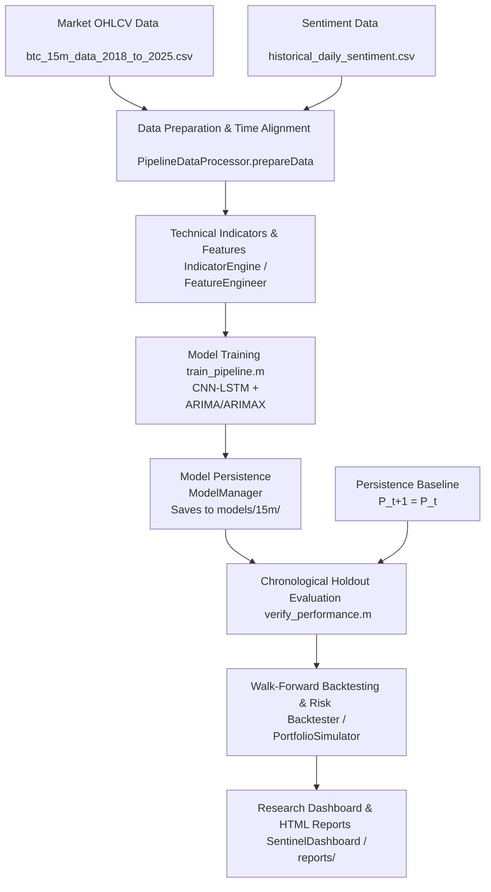

# SentinelCrypto: Sentiment Analysis & Quantitative Forecasting in Cryptocurrency Trading

> [!IMPORTANT]
> **Research Prototype & Academic Submission Only**  
> This repository is an academic research prototype developed for the MathWorks Excellence in Innovation Program (Project #239).  
> **No live capital is at risk.** Backtesting and evaluation reflect historical simulation with realistic market frictions.  
> **Predictive Performance Notice**: In empirical chronological holdout testing, the machine-learning ensemble **does not outperform the naive random-walk persistence baseline**. Passing all engineering and software tests indicates architectural correctness, not predictive alpha or trading profitability (see [Empirical Benchmark Results](#empirical-benchmark-results) and [Known Limitations](#known-limitations)).

---

## 1. Project Overview & Scope

Cryptocurrency markets operate 24/7 with extreme volatility influenced by order flow, technical momentum, and social sentiment. **SentinelCrypto** is an end-to-end, native MATLAB quantitative trading research platform that:
1. Ingests and synchronizes high-frequency market data and sentiment series onto a continuous regular grid.
2. Derives 20 technical indicators using strictly trailing, causal windows to prevent look-ahead bias.
3. Builds genuine 30-bar temporal sequence tensors for deep learning and aligns sentiment with a +1 calendar day lag.
4. Trains a hybrid forecasting ensemble combining a **CNN-LSTM** network (Deep Learning Toolbox) with an **ARIMA/ARIMAX** autoregressive model (Econometrics Toolbox).
5. Enforces quantitative risk controls (ATR-based dynamic Stop-Loss/Take-Profit, minimum 1.5 Risk/Reward filter).
6. Conducts walk-forward out-of-sample backtesting with realistic execution frictions (slippage, fees, conservative same-bar TP/SL ambiguity handling).
7. Visualizes forecasts and metrics in a modular research dashboard (`SentinelDashboard.m` / `App.m`).

**Current Status**: **Research Prototype — Fully Hardened & Scientifically Audited**. All look-ahead leakage, fabricated indicators, and silent fallback defects identified in the original MathWorks review have been remediated and verified with automated regression tests.

---

## 2. Dataset Architecture & Frequency Distinction

The repository maintains strict separation between datasets of different frequencies and purposes:

| Dataset Path | Rows | Frequency | Role in Repository |
| :--- | :--- | :--- | :--- |
| `data/market/btc_15m_data_2018_to_2025.csv` | 295,917 | 15-minute | **Primary high-frequency intraday market data** (2018–2026). Synchronizes to 296,446 regular grid rows. |
| `data/market/Real_Bitcoin_Price_History_2015_2026.csv` | ~4,000 | Daily | **Historical daily reference series**. Not a substitute for 15-minute intraday candles. |
| `data/market/btc.csv` | 4,994 | Daily | **Daily market dataset** used for daily baseline pipeline execution and legacy compatibility. |
| `data/sentiment/historical_daily_sentiment.csv` | 231 | Daily | **Aggregated daily sentiment scores** with timestamp alignment. |
| `data/sentiment/cryptolin.csv` | 20 | Headline | **Demonstration fixture** (10 positive, 10 negative) for text classification LOOCV validation. |
| `data/sentiment/Bitcoin_tweets.csv` | 40,000+ | Unlabeled | **Raw social media corpus**. Unlabeled; excluded from supervised training. |

*Safety Notice*: The archived reference corpus in `re solution prompt's/` is strictly protected and never modified by pipeline operations.

---

## 3. How the Project Works (End-to-End Workflow)



### Data Flow Breakdown
1. **Ingestion & Synchronization**: Market OHLCV candles and sentiment series are loaded and synchronized onto a regular canonical grid. Missing intervals are forward-filled for context, while synthetic target rows are masked out of supervised training loss.
2. **Feature Engineering**: Vectorized technical indicators (SMA, EMA, MACD, RSI, Bollinger Bands, VWAP, ATR) are computed using strictly trailing windows `[N-1 0]` to eliminate look-ahead bias. Sentiment observations receive a $+1$ calendar day lag.
3. **Model Training & Persistence**: `train_pipeline.m` trains the CNN-LSTM deep network and ARIMA/ARIMAX autoregressive models. `ModelManager` persists trained artifacts, scalers, target scalers, and feature lists into isolated interval directories (`models/15m/`).
4. **Holdout Evaluation & Backtesting**: Trained models and the persistence baseline are evaluated on a strict chronological holdout partition. The strategy simulation applies dynamic ATR position sizing, execution fees (0.1%), and slippage (0.05%) to compute net portfolio equity curves and risk metrics (Sharpe, Sortino, VaR, CVaR).

---

## 4. Repository Layout & Supporting Folders

```text
.
├── data/                 # Market and sentiment datasets (CSV files)
├── models/               # Saved model artifacts, scalers, and JSON metadata
├── reports/              # Generated HTML reports (Leaderboard, Health, Audit)
├── scripts/              # Operational, verification, and profiling scripts
├── src/                  # MATLAB source code (OOP classes and packages)
│   ├── dashboard/        # Modular research workstation UI (App.m, SentinelDashboard.m)
│   ├── data/             # Data ingestion, regular-grid synchronization, scaling
│   ├── feature_engineering/ # Incremental feature calculations (<1ms)
│   ├── forecasting/      # Trajectory projection and confidence bounds
│   ├── indicators/       # Vectorized technical indicators (trailing windows)
│   ├── loaders/          # Batch historical and live Binance REST polling
│   ├── models/           # ModelManager for artifact persistence and reload
│   ├── reporting/        # Automated HTML report generator classes
│   ├── risk/             # ATR stops and empirical VaR/CVaR calculations
│   ├── sentiment/        # Macro and textual sentiment processing
│   ├── strategy/         # PortfolioSimulator and parameterized database logging
│   └── utils/            # Logger, ConfigManager, SystemHealthCheck
├── tests/                # Unit, integration, causality, and backtesting test suites
├── docs/                 # Methodology, architecture, data, and evaluation notes
├── startup.m             # Adds project source and test folders to the MATLAB path
├── train_pipeline.m      # Trains models for a selected interval
├── run_pipeline.m        # Experimental event-driven prediction loop
├── run_all_tests.m       # Canonical test suite and verification runner
└── README.md
```

---

## 5. Entry-Point Scripts Table

| File | Purpose | When to run | Dependencies | Output or Side Effects |
| :--- | :--- | :--- | :--- | :--- |
| `startup.m` | Initializes MATLAB path by adding `src/`, `tests/`, and subfolders. | **Step 1** (Always run first) | Base MATLAB | Modifies search path. |
| `run_all_tests.m` | Executes all unit, integration, causality, and backtesting test suites. | **Step 2** (Verification) | Deep Learning, Econometrics, Stats Toolboxes | Prints test results, generates verification report. |
| `train_pipeline.m` | Trains CNN-LSTM and ARIMA/ARIMAX models for a given interval and row cap. | **Step 3** (Training) | Dataset files, Deep Learning, Econometrics Toolboxes | Saves trained `.mat` artifacts in `models/<interval>/`. |
| `scripts/verify_performance.m` | Evaluates trained ensemble against the persistence baseline on holdout data. | **Step 4** (Evaluation) | Trained model artifacts in `models/15m/` | Prints MAE, RMSE, and directional accuracy comparison table. |
| `run_pipeline.m` | Launches event-driven live/historical prediction loop and dashboard UI. | **Step 5** (Dashboard UI) | Saved model artifacts, live network (optional) | Opens `SentinelDashboard` figure window. |
| `verify_results.m` | Recomputes historical backtest metrics and asserts against authenticated baseline. | Optional Audit | Historical market data, Backtester | Exits non-zero if claim discrepancy is detected. |
| `verify_submission.m` | Runs end-to-end system health checks, test suite, and compliance checks. | Optional Audit | Full test suite | Generates comprehensive HTML verification report in `reports/`. |
| `quick_forecast.m` | Legacy quick-forecast entry point. | Deprecated | Binance API (live) | Prints quick forecast (subject to network availability). |
| `evaluate_pipeline.m` | Legacy pipeline evaluator. | Deprecated | Prior session logs | Evaluates saved execution logs. |

---

## 6. Important Source Modules Reference

| Module Path | Responsibility | Inputs | Outputs / Side Effects | Called By | Covered By Tests |
| :--- | :--- | :--- | :--- | :--- | :--- |
| `src/loaders/PriceDataLoader.m` | Batch historical loading & live Binance REST polling. | Symbol, Interval | Timetable / Table of OHLCV candles | PipelineDataProcessor, run_pipeline | `test_PhaseA_DataIngestion` |
| `src/data/PipelineDataProcessor.m` | Regular-grid synchronization, scaling, and target masking. | Raw tables, interval | `fullData`, scaled `X`, `Y` | train_pipeline, verify_performance | `test_P0_04_TemporalSequences` |
| `src/indicators/IndicatorEngine.m` | Technical indicators using strictly trailing windows (`[N-1 0]`). | Price table | Calculated indicator columns | FeatureEngineer, PipelineDataProcessor | `test_B01_LookAheadBias`, `test_B02_FabricatedFeatures` |
| `src/models/ModelManager.m` | Artifact persistence, metadata logging, and model reload. | Directory path | Model structs, scalers, feature list | train_pipeline, verify_performance | `test_B03_AlignmentAndModelIntegrity` |
| `src/strategy/PortfolioSimulator.m` | Portfolio simulation with fees, slippage, and net equity risk. | Prices, predictions | Performance metrics struct | PortfolioSimulationTab, Backtester | `test_B08_Backtester` |
| `src/dashboard/App.m` / `SentinelDashboard.m` | Modular research workstation UI. | App state, models | Interactive figure window | run_pipeline | `test_B04_LiveInferenceIntegration` |

---

## 7. Recommended Execution Order

### Step 1 — Initialize MATLAB Path
Open MATLAB R2026b, set the Current Folder to the repository root, and run:
```matlab
startup
```

### Step 2 — Run Automated Test Suite
Verify that all test units pass successfully:
```matlab
run_all_tests
```
*Expected Result*: All regression suites pass, verifying causal indicators, sequence tensor shapes, and backtesting logic.

### Step 3 — Train a Bounded Model Run
Train models with deterministic reproducibility on a bounded slice:
```matlab
% Syntax: train_pipeline(seed, interval, maxRows)
train_pipeline(42, '15m', 5000);
```
*Note*: This creates or replaces model artifacts in `models/15m/`. Back up existing artifacts if needed before retraining.

### Step 4 — Verify Model vs. Persistence Benchmark
Recompute forecasting errors on the chronological holdout partition:
```matlab
addpath('scripts');
results = verify_performance(500, 'models/15m');
disp(results);
```

### Step 5 — Launch Research Dashboard
Open the interactive UI:
```matlab
run_pipeline
```

---

## 8. Execution Rules & Important Guidelines

1. **Do not run every `.m` file individually**: Entry-point scripts (`startup`, `run_all_tests`, `train_pipeline`, `verify_performance`, `run_pipeline`) orchestrate the software. Classes and utility functions are called automatically.
2. **Preserve Protected Path**: Never access, read, or modify `re solution prompt's/`.
3. **Demo Video**: Intentionally **SKIPPED PER USER** (`SKIPPED PER USER`).
4. **Artifact Isolation**: When training new models, use isolated output directories to avoid overwriting baseline verification artifacts.

---

## 9. Outputs, Common Failure Cases & Troubleshooting

- **Missing Toolboxes**: Ensure Deep Learning, Econometrics, and Statistics Toolboxes are installed. (Financial Toolbox is not required).
- **Missing Artifacts**: If `verify_performance` or dashboard simulation fails due to missing `.mat` files, run `train_pipeline(42, '15m', 5000)` first.
- **Network Outages**: Live Binance polling (`PriceDataLoader`) requires internet access. If offline, the pipeline automatically falls back to committed historical CSV datasets (`data/market/btc.csv` or `btc_15m_data_2018_to_2025.csv`).
- **Benchmark Underperformance**: If models underperform persistence, review empirical benchmark notes. This is a known, honestly disclosed market efficiency limitation, not a software failure.

---

## 10. License & Attribution

- **Author**: Karan Chhunchha (karanchhunchha@gmail.com)
- **Challenge**: MathWorks Excellence in Innovation Program (Project #239)
- **License**: MIT License - see [LICENSE](LICENSE) for details.
